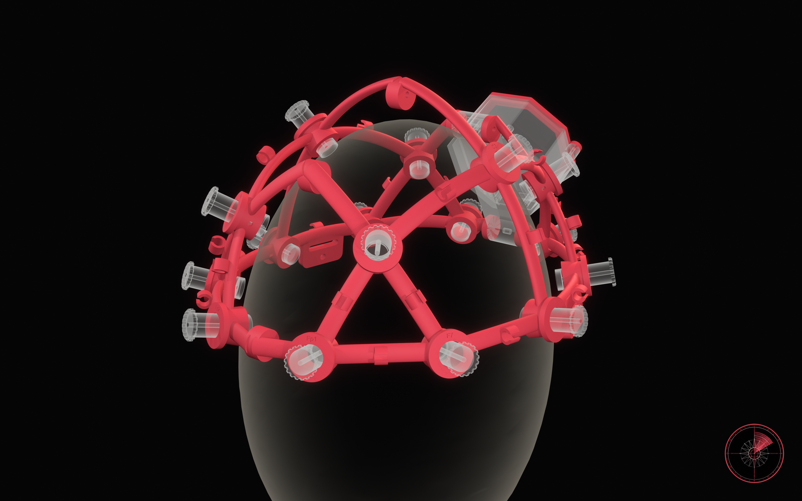
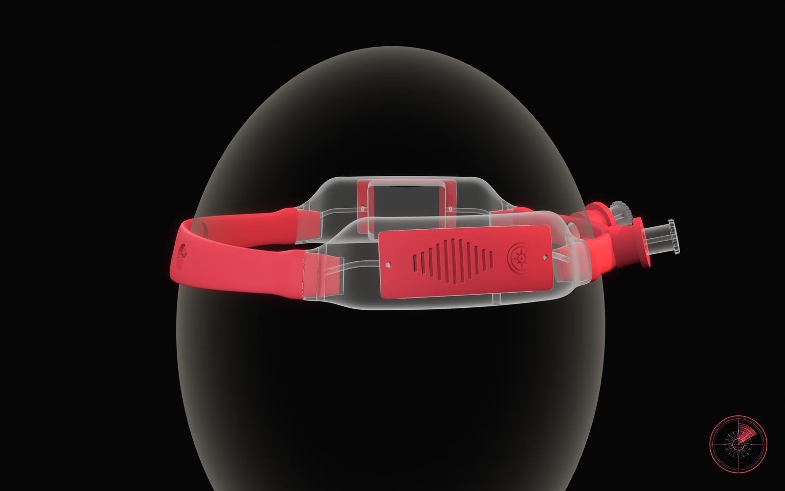
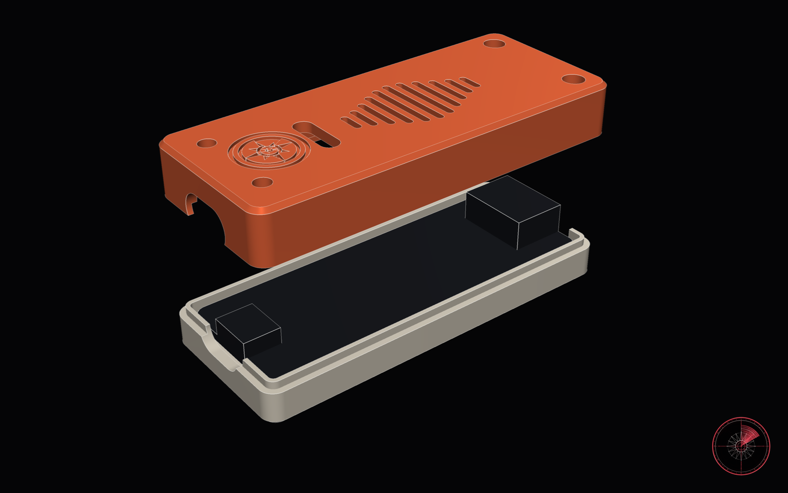

# the-hardware

Open, 3D-printable parts for thermodynamic computing, neuromorphic engineering, brain-signal
recording and small-satellite education. Every part is generated from code (CadQuery), so you can
read it, change a parameter and build it again.

License: [CERN-OHL-S v2](LICENSE). Attribution is required. If you share a changed design or
sell a product made from it, you must publish your changed source under the same license.

| [EEG headset frame](designs/eeg-headset-frame/) | [EEG band](designs/eeg-band/) | [Tang Nano 9K case](designs/tang-nano-9k-case/) |
|---|---|---|
|  |  |  |

## Films

Every hardware film is linked here and in the README of its design.

| Film | Design |
|---|---|
| [](https://youtu.be/5YII1HK1nv0)<br>[Print an EEG headband and see your blinks and alpha waves](https://youtu.be/5YII1HK1nv0) (1:06) | [eeg-band](designs/eeg-band/), [eeg-viewer](software/eeg-viewer/) |
| [](https://youtu.be/r6wWGMYatmw)<br>[Print an EEG headset and watch your brain in the browser](https://youtu.be/r6wWGMYatmw) (1:06) | [eeg-headset-frame](designs/eeg-headset-frame/), [eeg-viewer](software/eeg-viewer/) |
| [](https://youtu.be/6x5qe1VAy_4)<br>[A box for a computer that runs on noise](https://youtu.be/6x5qe1VAy_4) (1:56) | [tang-nano-9k-case](designs/tang-nano-9k-case/) |

## Designs

| Design | For | State |
|---|---|---|
| [tang-nano-9k-case](designs/tang-nano-9k-case/) | Sipeed Tang Nano 9K FPGA board, used by the [thermospike](https://github.com/tlcdv/thermospike) FPGA reference design | v0.1.1. Fit checked in CAD only. **Not printed yet.** |
| [eeg-headset-frame](designs/eeg-headset-frame/) | 16-channel EEG headset frame, sizes S, M, L, for the OpenBCI Cyton board with the Daisy module and OpenBCI 5 mm dry comb electrodes. Recording only. [Build guide](https://theconsciousness.ai/hardware/designs/eeg-headset-frame/), [live viewer](https://theconsciousness.ai/hardware/eeg-viewer/) | v0.1.0. Checked in CAD only. **Not printed yet.** |
| [eeg-band](designs/eeg-band/) | 3-channel EEG band, sizes S, M, L, on the 10-20 ring (Fp1, O1, O2), for the Upside Down Labs NPG Lite wireless board in a side pod. Recording only. [Build guide](https://theconsciousness.ai/hardware/designs/eeg-band/), [band demo in the viewer](https://theconsciousness.ai/hardware/eeg-viewer/?demo=band) | v0.2.0. Checked in CAD only. **Not printed yet.** |
| `optical-kuramoto-bench` ([Issue #3](https://github.com/tlcdv/the-hardware/issues/3)) | 4-block optical-electronic hybrid Kuramoto and p-bit bench (`OKB-BENCH v0.1.0`) holding a 650 nm collimated laser module, a 25.4 mm 50-50 beamsplitter cube, a high-speed silicon PIN photodetector and the Sipeed Tang Nano 9K FPGA. [Architecture & BOM](https://theconsciousness.ai/photonic-substrate/#benchtop-prototype-bom) | **Planned ([Issue #3](https://github.com/tlcdv/the-hardware/issues/3)).** Open task for next hardware CAD session. |

## Software

| Software | What it does | State |
|---|---|---|
| [eeg-viewer](software/eeg-viewer/) | Live EEG in the browser for the EEG headset frame, the EEG band (NPG Lite), a Muse or an OpenBCI Cyton, with spectrum, band power, alpha head map, contact check, eyes closed test and CSV recording. MIT. [Open it](https://theconsciousness.ai/hardware/eeg-viewer/) | v0.1.0. Muse and OpenBCI decoders match the muse-js and OpenBCI reference test data. The NPG Lite decoder follows the maker's published packet layout. **Not run with a real device yet.** |


## Two variants of each part

If you sell prints of these designs, use the `store` variant. No name or mark of this project
may appear on a part that is sold. See [NOTICE](NOTICE).

| Variant | Marks on the part | Use |
|---|---|---|
| `store` | Part number and license name only | Print services |
| `branded` | Project mark and the source URL | Personal prints only. Never sold, never listed on a print service |

The shape is the same. Renders use the project's colours: near black background, orange
`#ff6f40` (Tang Nano case) or red-pink `#e64254` with clear glass parts (EEG frame and EEG band), cream, thin near white edge lines, and the main logo at the bottom right
(`python render.py <design>`). Copies without the logo go to `renders/listing/` for print service
listings. All parts share one shape language (`common/style.py`): the same edge
radius and chamfer, and a row of vent slots whose lengths follow a Boltzmann distribution,
exp(-E / T).

## Build

```
python -m venv .venv
.venv/Scripts/python -m pip install -r requirements.txt   # Windows
# .venv/bin/python -m pip install -r requirements.txt     # Linux, macOS
python build.py           # STL and STEP into designs/<name>/files/, plus fit checks
python build.py --check   # fit checks only
python render.py tang-nano-9k-case
python render.py eeg-headset-frame
```

The fit checks fail when a part is not one valid solid, when two parts of a case overlap, or when a
case overlaps the simplified board model.

Ready STL and STEP files are attached to each [release](https://github.com/tlcdv/the-hardware/releases).

## Honest test state

Each design README has a test table. A design is "printed" only after a real print, and "fit
tested" only after a real board was mounted in it. Until then, measurements that are not in the
manufacturer's drawing are marked as estimates.

## Source location

The source of every design is this repository:
https://github.com/tlcdv/the-hardware. See [NOTICE](NOTICE).

## Contributing

See [CONTRIBUTING.md](CONTRIBUTING.md). Outside contributions need a signed
[contributor license agreement](CLA.md).
