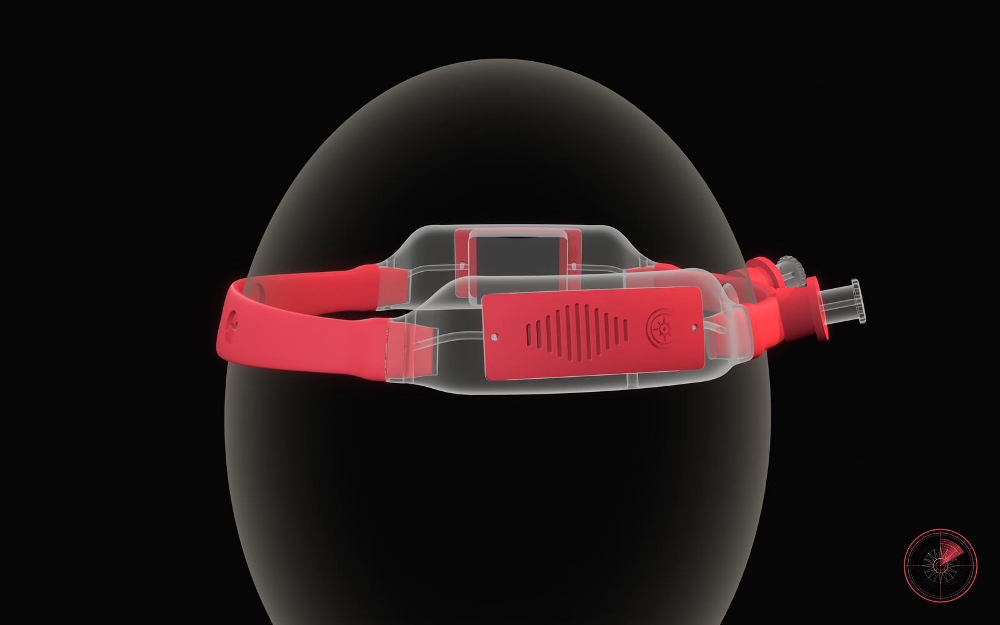
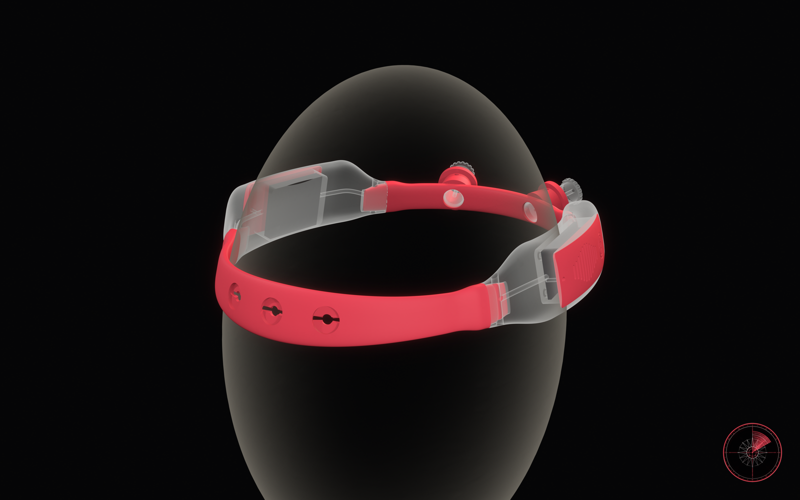
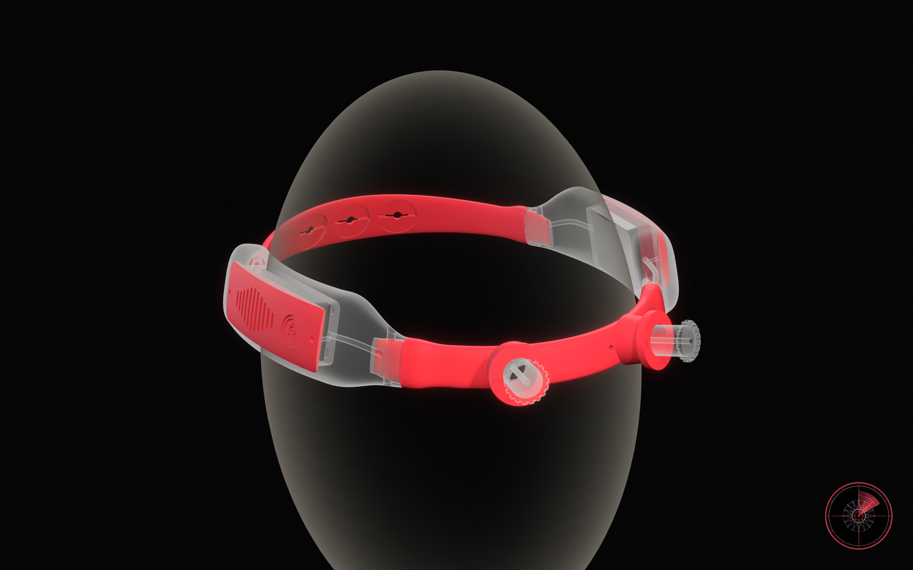
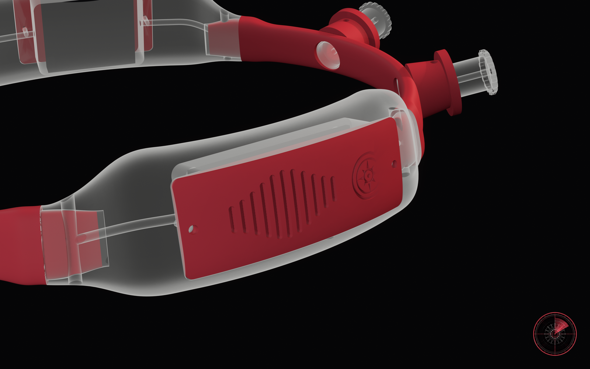

# Open EEG band (EEGB) v0.2.0

A 3D-printable band with 3 EEG channels and a small wireless board. It is one closed ring on the
circumference line of the 10-20 map, 10 % above the nasion and the inion. One sensor sits on the
forehead at Fp1 and two sit at the back of the head at O1 and O2. The board rides in a slim pod
above one ear and its battery in a pod above the other. It is our own design, made from scratch in
[`design.py`](design.py), and it uses the head model, the hub and the electrode carrier of the
[EEG headset frame](../eeg-headset-frame/).

Board: Upside Down Labs Neuro PlayGround Lite (NPG Lite), 3 channels, ESP32-C6, Bluetooth LE,
Adafruit Feather size, battery powered. The [Open EEG Viewer](../../software/eeg-viewer/) reads it
over Web Bluetooth. Variant B (wired): an Arduino Nano ESP32 in the board pod and 3 BioAmp EXG
Pill boards in the battery pod.

Recording only. This is not a medical device. It does not diagnose or treat anything, and it has
no part for stimulation. Use a battery. If you use variant B on USB, run the computer on its
battery, never on the wall supply.



Build guide with the parts list: https://theconsciousness.ai/hardware/designs/eeg-band/

## The shape

The whole ring is one smooth loft. Its cross-section is a superellipse (a rounded lens) whose
width and thickness change along the ring. It is wide and thin on the forehead, with a collar at
each joint, a pod above and behind each ear (at 100 degrees from the front) and a firm arc at the
back. One script makes sizes S, M and L for 540, 570 and 600 mm head circumference.

## Parts

| Part | Material | Print | Files |
|---|---|---|---|
| Front band, S, M or L | TPU 95A | 1 | `files/eeg-band-<size>-front.stl` |
| Board pod (left), S, M or L | PETG, clear | 1 | `files/eeg-band-<size>-pod-board.stl` |
| Battery pod (right), S, M or L | PETG, clear | 1 | `files/eeg-band-<size>-pod-battery.stl` |
| Rear arc with the O1 and O2 hubs, S, M or L | PETG | 1 | `files/eeg-band-<size>-rear.stl` |
| Board cover | PETG | 1 | `files/eeg-band-cover-board-store.stl` or `-branded` |
| Battery cover | PETG | 1 | `files/eeg-band-cover-battery.stl` |
| Electrode carrier | PETG, clear | 2 | `files/eeg-band-carrier.stl` (same as the frame carrier) |

The front band has snap sockets at Fp1, Fpz and Fp2 (a 4 mm stud, a 12 mm counterbore for the
lead connector and a 20 mm recess for the electrode disc inside). Fpz and Fp2 are spare sockets.
A tongue at each end of the front band and the rear arc slides into a socket in the pod, and one
M3 bolt across the band holds each joint. A 2.4 mm channel inside the band carries the leads. The
battery lead runs from the right pod through the rear arc to the board in the left pod. The board
pod has a hole for the earclip lead. The rear arc carries the names O1 and O2 engraved on the hubs,
so it has no store or branded variant. Only the board cover has a branded variant, with the compass
mark beside the Boltzmann vents.

Bought parts: NPG Lite board, 1S LiPo pouch cell with a PicoBlade plug and a protection circuit
(503035 type, 5 x 30 x 35 mm; the pod takes up to 8 x 30 x 40 mm), a thin foam pad under the cell,
2 OpenBCI 5 mm dry comb electrodes, 1 to 3 snap electrodes (gel or dry) for the forehead,
1 earclip electrode for the reference, 4 M3 x 25 bolts with lock nuts (joints; the band is 21 to
22 mm wide there), 4 M2.5 x 4 self-tapping screws (board), 4 M2 x 8 self-tapping screws (covers),
2 M3 x 6 set screws (carriers).

Warning from the maker of the board: the battery input of the NPG Lite has no polarity
protection. Check the plug polarity before you connect a battery.

## Images

Renders in Blender from the exported meshes, not photos. The glass shape is the ellipsoid head
model. The dark blocks in the pods are simplified models of the board and the battery.

| | |
|---|---|
|  |  |
| From the front: the soft band with the Fp1, Fpz and Fp2 sockets | From the back: the hubs at O1 and O2 |
|  |  |
| From the side: the board pod above the ear | The board pod, branded cover |

Copies without the logo, for print service listings, are in [`renders/listing/`](renders/listing/).

## Test state

| Check | State |
|---|---|
| Parts overlap in CAD (front/pods, rear/pods, covers/pods, board and battery with pods and covers) | Passed, 0.000 mm3, sizes S, M, L |
| Board and battery inside the closed pods | Passed, 0.000 mm3 outside, sizes S, M, L |
| Variant B proxies (Nano ESP32, 3 EXG Pills) in the pods and covers | Passed, 0.000 mm3. Outline proxies only |
| Front band to scalp on the head model | 0.5 mm (the band presses it on) |
| Pods to scalp on the head model | Passed, 0.5 mm (minimum 0.3 mm, the pod ends meet the front band). The lowest point of the pods is 28 to 33 mm above ear canal level |
| Rear arc to scalp on the head model | Passed, 3.0 mm (minimum 2.5 mm) |
| Carriers in the hubs at the contact position | Passed, 0.000 mm3 overlap, carrier 4.1 mm above the scalp model before you push it down |
| Each part inside a 250 x 250 x 250 mm print volume | Passed. The largest part (L front) is 163 mm |
| Board outline and holes | **Estimate.** Adafruit Feather standard (50.8 x 22.86 mm, holes 2.54 mm from the corners). Upside Down Labs publishes no drawing of the NPG Lite |
| Room above the board | **Estimate.** 7 mm, base board only |
| Channel wiring (which input goes to Fp1, O1, O2, the reference and the bias) | **Not checked** with the maker's docs |
| Snap socket | For a 4 mm snap stud. **Not checked** with a real electrode |
| NPG Lite source in the viewer | Built from the maker's published packet layout, decoder tests pass. **Not run with a real board** |
| Printed | **No** |
| Tried on a head | **No** |
| Signal recorded with this band | **No** |

Do not order a print for a project that depends on it until the "Printed" and "Tried on a head"
rows say yes.

## Film

[](https://youtu.be/5YII1HK1nv0)

[Print an EEG headband and see your blinks and alpha waves](https://youtu.be/5YII1HK1nv0) (1:06, YouTube) shows the band on the 10-20 ring, the three sizes from one script, the board
and the battery in their side pods, and the [Open EEG Viewer](../../software/eeg-viewer/) with the band demo. The band shots
are renders of this CAD. The brain waves in the film are open PhysioNet data, not recorded with the band. A blink is an eye
signal (EOG), not a brain signal.

## Build

```
python build.py          # exports files/ and runs the checks of every design
python build.py --check  # checks only
```

## License

CERN-OHL-S-2.0, like every design in this repository. See the root [LICENSE](../../LICENSE)
and [NOTICE](../../NOTICE). The `store` files carry no name or logo. The `branded` files are for
personal prints only.
