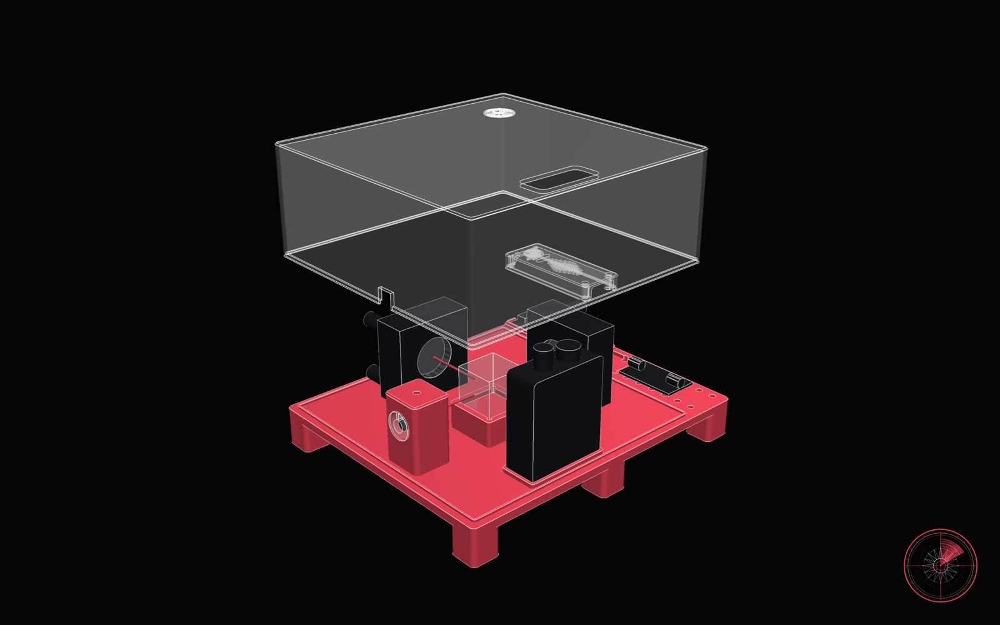
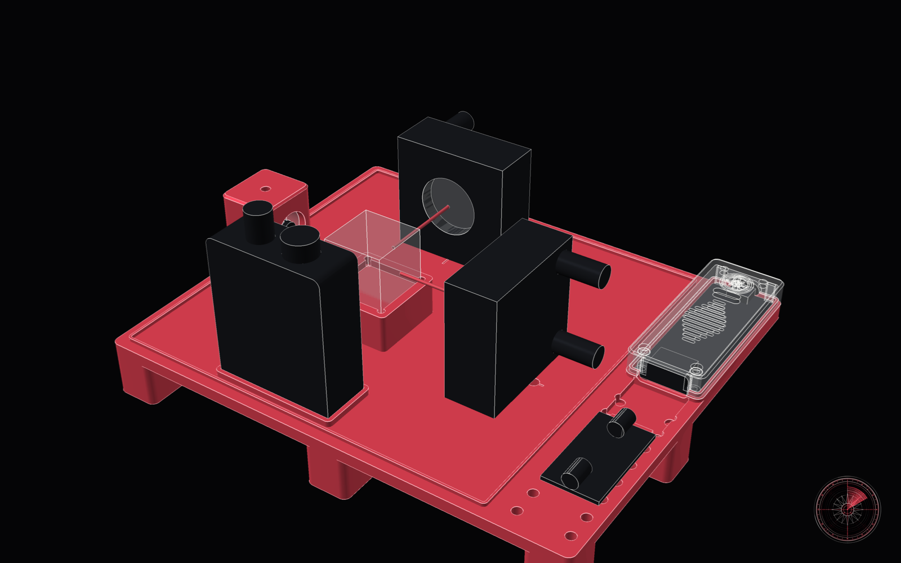
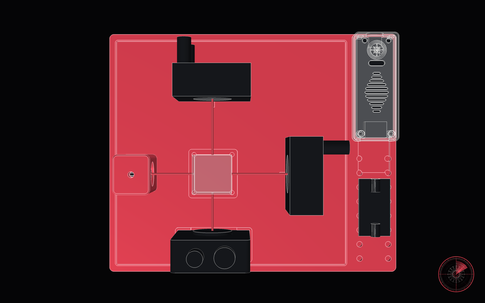
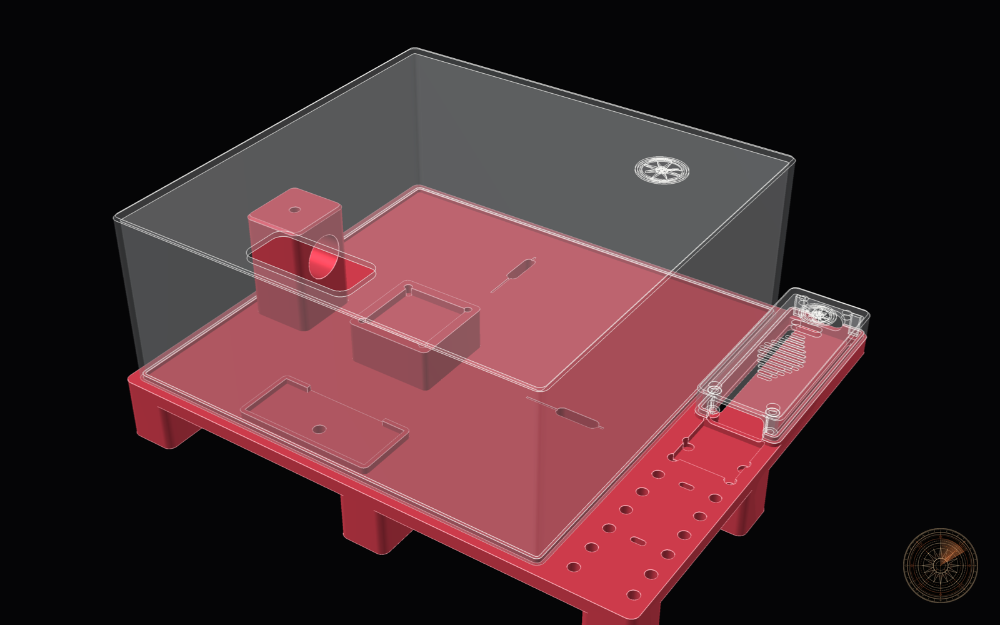
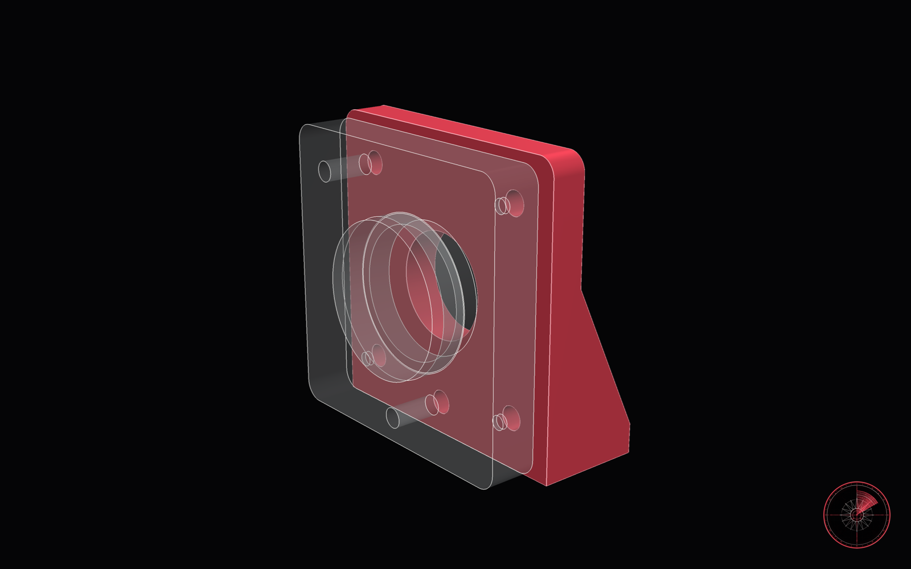

# Optical Kuramoto bench (OKB-BENCH) v0.1.0

A printed base for a small optical-electronic loop on a desk. A red laser goes into a 25.4 mm
50:50 beamsplitter cube. Two mirrors send the two beams back, and the cube puts them together
again (a Michelson interferometer). A fast silicon detector reads the light. A fast comparator
turns the detector signal into a 3.3 V logic signal for a Sipeed Tang Nano 9K FPGA. An
oscilloscope shows the detector and FPGA signals.

It is the benchtop part of the physics blueprint on
[/photonic-substrate/](https://theconsciousness.ai/photonic-substrate/#benchtop-prototype-bom).
The build guide is at [/hardware/designs/optical-kuramoto-bench/](https://theconsciousness.ai/hardware/designs/optical-kuramoto-bench/).

> **Laser safety.** The laser modules are Class IIIa (under 5 mW). Never look into the beam or a
> reflection of it. Keep the shroud on when you do not adjust the optics. Take off rings and
> watches before you align the mirrors.

## Film

[Can a computer bind rhythms at the speed of light?](https://youtu.be/ESYS1505OEs) (1:54, YouTube) starts from a thought experiment: nerve signals move at
most 120 m/s, light in glass is more than a million times faster. It shows three experiments that compute with
light (Inagaki et al. 2016, Shen et al. 2017, Feldmann et al. 2019), our own rhythm test that failed, and then this
bench part by part, with the light path through the cube and the two mirrors. The bench shots are renders of this
CAD. The bench is not printed yet. The scope trace at the end is a Kuramoto simulation, not a measurement.

## Images

CAD renders, not photos. The dark blocks are simplified models of the bought parts (detector,
KM100 mounts, FPGA board, comparator). The thin red line is the light path.

| | |
|---|---|
|  |  |
| Base with the bought parts and the light path | Top view. Laser (left), cube (centre), mirrors (right and top), detector (bottom) |
|  |  |
| Closed, branded variant (compass mark on the shroud and the FPGA lid) | Closed, store variant |
|  | |
| Printed kinematic mirror mount, with the bracket and the mirror plate | |

Copies without the logo, for print service listings, are in [`renders/listing/`](renders/listing/).
Render colours follow the house look: red-coral printed parts, clear glass covers.

## Test state

| Check | State |
|---|---|
| DET10A2 body, aperture height and screw tap | From the Thorlabs drawing TTN133878-E0W (rev A) |
| DET10A2 BNC and battery cap position on top | **Estimate** from the drawing views, +-2 mm |
| KM100 size and optic height (25.4 mm) | From the Thorlabs drawing 6628-E0W (rev C) |
| KM100 M4 screw position under the mount | **Estimate.** The base has a 16 mm slot to allow for it |
| Tang Nano 9K bay and lid | Same geometry as [tang-nano-9k-case](../tang-nano-9k-case/) v0.1.1 |
| Comparator module (TLV3501, SMA) | **No drawing found.** The tray is a grid of M3 holes and two cable-tie slots |
| Fit in CAD | Passed: 0.000 mm3 overlap for base, shroud, lid, light path (3 mm wide), every bought part, both mirror mount options and the sleeves |
| Printed | **No** |
| Tested with optical parts | **No** |
| Interference fringes seen | **No** |

Checked in CAD only. Not printed and not tested with optical components yet.

## The four blocks

| Block | Where | What the bench holds |
|---|---|---|
| 1. Light source | -X | Cradle with a 16.4 mm bore and an M3 lock screw (heat-set insert). Printed split sleeves for 7 mm (Quarton VLM-650-03), 11 mm (Thorlabs CPS635R) and 12 mm laser modules. Optical axis 25.4 mm above the plate |
| 2. Routing and interference | centre, +X, +Y | Seat for the 25.4 mm cube with corner relief. Two mirror pads 50 mm from the cube centre (equal arms). Each pad takes a Thorlabs KM100 or the printed kinematic mount (same optic height, same M4 slot) |
| 3. Detection and feedback | -Y, right column | Rim seat and M4 hole for the DET10A2. Tray for a fast comparator module. Tang Nano 9K bay with header slots, and the lid with the 11 Boltzmann vent slots |
| 4. Readout | off the bench | Coax cables from the detector BNC and the comparator SMA to a 200 MHz oscilloscope |

The noise source for the feedback loop is planned in FPGA gateware (an LFSR). A TrueRNG v3 can
give reference noise on a PC. It does not connect to the bench.

## Files

| Part | Quantity | store variant | branded variant |
|---|---|---|---|
| Base | 1 | `optical-kuramoto-bench-base-store` | `optical-kuramoto-bench-base-branded` |
| Shroud (light cover) | 1 | `optical-kuramoto-bench-shroud-store` | `optical-kuramoto-bench-shroud-branded` |
| FPGA lid | 1 | `optical-kuramoto-bench-lid-store` | `optical-kuramoto-bench-lid-branded` |
| Laser sleeve | 1 (pick 7, 11 or 12 mm) | `optical-kuramoto-bench-sleeve-7mm` (and `-11mm`, `-12mm`) | same |
| Mirror bracket | 2 (printed mount only) | `optical-kuramoto-bench-mirror-bracket` | same |
| Mirror plate | 2 (printed mount only) | `optical-kuramoto-bench-mirror-plate` | same |

STL and STEP in [`files/`](files/). Build them with `python build.py`.

## Sizes

| Part | Size |
|---|---|
| Base | 200.4 x 166.0 mm, 63.6 mm high with the feet and the laser cradle |
| Shroud | 164.0 x 160.0 x 64.0 mm |
| FPGA lid | 30.8 x 74.8 x 10.0 mm |

The base fits a 220 x 220 mm FDM bed. The 18 mm feet leave room for jumper wires on the FPGA
header pins, which come out under the base.

## Printing

- Materials are PETG on an FDM printer, or nylon PA12 (MJF or SLS). Fit allowance 0.2 mm per side.
- Use black or dark material for the shroud if you want less stray light. The renders show it
  clear.
- Print the base with its floor on the bed. Print the shroud and the lid with their top faces on the bed.
- Use M3 heat-set inserts (4.0 mm hole, 4 to 5 mm long) in the laser cradle, the comparator tray
  and the printed mirror brackets.
- Not tested. Supports may be needed under the laser bore on FDM.

## Assembly

1. Press the M3 heat-set inserts into the cradle, the comparator tray and the brackets.
2. Put the cube in its seat. Do not touch the optical faces.
3. Fix the two mirror mounts with M4 screws from under the base. A KM100 takes one M4 screw in
   its base hole. For the printed mount, use an M4 screw through the bracket foot, then the mirror plate on two M3
   pull screws with springs and three M3 adjuster screws (pivot, horizontal, vertical).
4. Fix the DET10A2 with an M4 x 6 screw from under the base. The SM1 boss faces the cube.
5. Put the laser in its sleeve, the sleeve in the cradle, and tighten the M3 lock screw lightly.
6. Put the Tang Nano 9K in the bay and the lid on it, as for the Tang Nano 9K case.
7. Fix the comparator module to the tray. Connect the detector BNC to the comparator input with a
   BNC to SMA adapter. Use a 50 ohm load for the 1 ns rise time.
8. Align with the shroud off and the laser at low power. Then put the shroud on.

## Parameters

All sizes are at the top of `design.py` (bench) and `components.py` (bought parts). Change one,
then run `python build.py`. The fit checks run each time.

## Changes

| Version | Date | Change |
|---|---|---|
| v0.1.0 | 2026-11-24 | First release. Michelson layout, comparator tray, two mirror mount options. |
